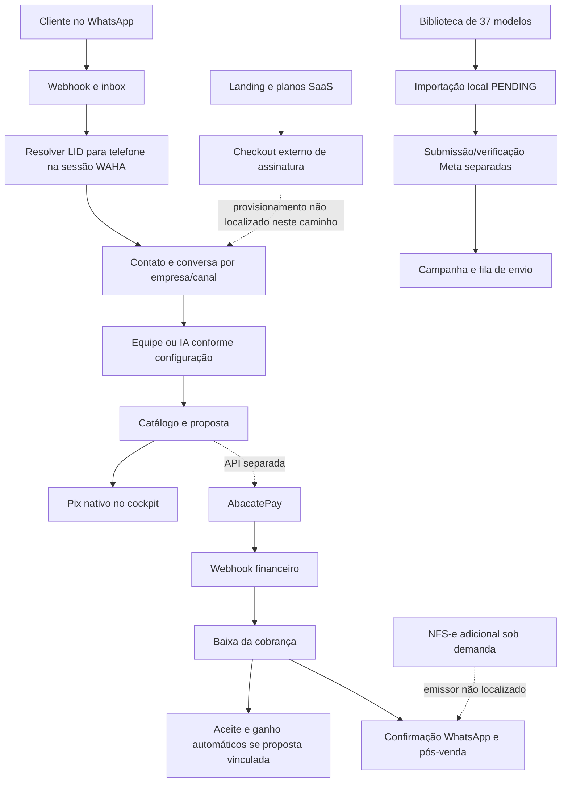

# SOS Vendas — auditoria de retomada após Antigravity

Início da coleta: **20/10/2026**; conclusão documental: **21/10/2026**, America/Sao_Paulo. Auditoria de leitura, sem deploy, migração, pagamento, envio de mensagem ou conexão de conta.

## Parecer

O produto evoluiu em apresentação, catálogo de modelos, checkout e tratamento de identidade WhatsApp. A base comercial continua reconhecível: atendimento → catálogo → proposta → cobrança → acompanhamento. Porém, as integrações novas ainda não sustentam a declaração de operação financeira/fiscal ponta a ponta.

**Disponibilidade pública verificada; homologação comercial não comprovada.** Os maiores problemas estão na composição dos processos, não na aparência: gateway com caminho v2 indireto, baixa sem conferência de valor, SQL incompatível com o esquema versionado, venda de balcão com contratos diferentes dos usados pelo núcleo e promessas de emissão fiscal sem implementação localizada.

## Fontes e estado observado

- Checkout: `/Users/franciscotaveira.ads/Downloads/FT/CHAT-SALES`; branch `codex/iteration-2.7`; HEAD `cf7e19c`. Árvore inicialmente limpa.
- Fontes declarativas: `CODEBASE.md`, `ATLAS.md` e `/Users/franciscotaveira.ads/.gemini/antigravity-ide/brain/8b3cacb9-290f-4eb3-bd6c-57fab06c8d86/sos-vendas-codex-handover.md`.
- Os documentos estão datados de 21/10. Há referências conflitantes a VPS antiga/nova, engine WAHA e contagem de migrações. São declarações a conferir, não recibos de execução. A data da sessão mudou de 20 para 21 durante a auditoria; isso não é tratado como defeito do produto.
- REA analisou sete arquivos centrais: gateway, rotas de cobrança/webhook/canais, inbox worker, biblioteca e sua interface. **22.707 nós AST, zero falhas de parse**. As 161 observações estáticas não equivalem a 161 defeitos.
- Produção, somente GET sem autenticação: `/health` 200 (`live`, versão `3.0.0-alpha.1`), `/ready` 200 (`ready`), `/v1/me` 401. Landing 200, com marca SOS Vendas. Esses endpoints não identificam o commit implantado nem comprovam transações.
- Docker local indisponível. Não foi iniciado nem reiniciado; testes PostgreSQL locais em `55440` não puderam executar.
- `protected-manifest.json`: hashes dos **64 arquivos SQL** e da biblioteca, **65 arquivos preservados**. A declaração de **44 migrações executadas em produção** exige consulta autorizada ao ledger real; não foi comprovada nem alterada.

## Como os processos estão conectados hoje

As linhas tracejadas indicam integração incompleta ou não demonstrada. O gráfico representa o código inspecionado; não é recibo de entrega real.

### Atendimento e identidade

Há resolução de `@lid` tanto na importação histórica (`channels.routes.ts:1704`) quanto no processamento de entrada (`inbox-processor.ts:139`). Ambos usam `/api/{session}/lids/{lid}` e leem `pn`, conforme [documentação WAHA](https://waha.devlike.pro/docs/how-to/contacts/).

Limites: a importação usa credencial do canal; o worker usa `WAHA_BASE_URL`/`WAHA_API_KEY` globais e sessão derivada do payload. Isso precisa ser reconciliado com o vínculo de sessão/canal antes de certificar múltiplas empresas/provedores. Erros de resolução histórica são ignorados; contatos podem ficar fora do lote sem diagnóstico específico. Não foi comprovada a fusão de contatos declarada nos documentos.

### Cobrança nativa versus gateway

A interface ganhou configuração AbacatePay. Existem rotas específicas para cobrança de conversa e proposta. Entretanto, os chamadores visuais inspecionados continuam usando o Pix nativo; os métodos AbacatePay no cliente não possuem chamadores React localizados. **Ativar o toggle não demonstrou trocar automaticamente o meio de cobrança do cockpit ou da IA.**

Há dois produtos financeiros distintos: checkout da assinatura do SOS Vendas e cobrança que uma empresa usuária faz aos clientes dela. O webhook atual procura uma `pix_charge` existente; não foi localizado nesse fluxo o provisionamento de workspace/licença após a compra da assinatura na landing.

### Modelos

A biblioteca é um avanço de usabilidade: filtros por segmento/categoria, busca, prévia e importação. Contagem executada do módulo: **37 modelos únicos**, 13 segmentos; 23 UTILITY, 13 MARKETING e 1 AUTHENTICATION. Arquivo preservado integralmente.

A importação grava `PENDING`, sem `metaTemplateId` (`templates.routes.ts:471`). Portanto, **importado não significa aprovado pela Meta nem pronto para disparo**. Landing promete 70+ e aprovação garantida; a interface promete aprovação imediata e janela gratuita de sete dias. Essas promessas não são demonstradas pela biblioteca ou pela importação. Também há duas representações do acervo: conteúdo TypeScript do cockpit e exemplos estáticos na landing.

### Venda de balcão e fiscal

A nova rota de balcão cria contato, proposta aceita e tenta registrar ganho/pós-venda. Porém usa `contacts.display_name/email`, `channel_instances.name`, `commercial_messages` e formato de outbox que não correspondem às migrações inspecionadas. Seleciona o canal mais recente/qualquer canal como fallback, contrariando a seleção explícita exigida pelo núcleo.

O campo `emitNfe` apenas produz `fiscalStatus: solicitada`; não foi localizado emissor ou execução fiscal correspondente. O pós-venda promete emitir PDF ao receber SIM, sem checagem de contratação do módulo. A landing separa a NFS-e adicional corretamente, mas a jornada operacional ainda não respeita essa fronteira de forma demonstrável.

## Achados priorizados

| Prioridade | Achado e evidência | Efeito e correção recomendada |
|---|---|---|
| P0 | **Corrigido no código local, validação pendente:** baixa sem conferir valor. `abacatepay.service.ts` | Agora exige centavos inteiros positivos, valor idêntico à cobrança e BRL antes da baixa/registro externo. Não executar em produção antes da validação isolada |
| P0 | **Corrigido no código local:** SQL inválido do pós-venda usava `outbound_commands.command_type/payload`, ausentes no esquema versionado | Removida essa gravação incompatível. A mensagem de pós-venda/fiscal não foi reimplementada; permanece pendente usar a fila real e respeitar o módulo fiscal opcional |
| P0 | **Corrigido no código local:** `commercial_outcomes.registered_by_user_id` é obrigatório, mas o webhook tentava gravar NULL | Webhook registra pagamento comprovado, aceita proposta sent válida e não inventa resultado ganho nem muda funil sem responsável humano |
| P0 | **Corrigido no código local, validação pendente:** webhook aceitava secret de URL **ou** HMAC hexadecimal próprio | Agora exige secret da URL e HMAC SHA-256 base64 calculado com a chave pública documentada pela AbacatePay. A [documentação oficial de segurança](https://docs.abacatepay.com/pages/webhooks/security) descreve assinatura e segredo; validar o contrato com payload assinado oficial antes de produção |
| P0 | **Corrigido no código local:** evento autenticado marcado `devMode` poderia seguir como baixa real | As rotas global e escopada agora reconhecem e ignoram eventos de desenvolvimento antes de liquidar cobrança |
| P1 | **Parcialmente corrigido no código local, sem teste após a edição:** as rotas de cobrança por conversa e proposta exigem `requestKey`, serializam replays, validam fingerprint e reaproveitam cobranças salvas; a chave é propagada como `externalId`/metadata v2 | Resolve replay normal e resposta perdida depois do commit. Falha do provedor ou do banco entre criação externa e commit local ainda pode deixar cobrança órfã; requer ledger de reserva/reconciliação com estado durável, sem alterar migrações nesta correção |
| P1 | **Corrigido no código local, validação pendente:** eventId usava `Date.now`, recibos não detectavam payload conflitante e charge ausente recebia 404 sem retry | Agora usa ID do evento do provedor (ou hash estável do corpo quando ausente), compara hash e retorna duplicidade idempotente; conflito retorna 409. Cobrança ainda não visível retorna 503 para permitir retentativa documentada. Ainda precisa passar em PostgreSQL 16 isolado |
| P1 | **Corrigido no código local, validação pendente:** seleção V2 e contrato de criação transparente | Chaves com prefixo `abc_dev_`/`abc_prod_` vão direto a `/v2/transparents/create`, sem chamada v1 anterior; `metadata` dentro de `data`, conforme [contrato de criação](https://docs.abacatepay.com/pages/transparents/create). A chamada e incerteza de rede ainda não foram validadas após esta alteração |
| P1 | **Corrigido no código local:** payload V2 perdia metadata do workspace/conversa | `data.metadata` agora preserva workspace e correlação para o webhook global. Confirmar que os chamadores realmente preenchem `workspaceId` e `chargeId` antes de considerar resolvido ponta a ponta |
| P1 | **Corrigido no código local:** baixa aceitava proposta em estado não elegível e tentava marcar oportunidade ganha | Apenas proposta `sent` e ainda válida pode ser aceita. Ganho da oportunidade permanece uma ação separada, sem ator humano fabricado |
| P1 | Balcão usa tabelas/colunas de outro contrato e promete NFS-e sem módulo verificado | Unificar com núcleo de contato/conversa/fila, exigir canal explícito e condicionar fiscal à contratação. Não marcar “despachado” apenas por inserir em fila |
| P1 | Chaves/segredos AbacatePay em colunas textuais e literais de chave em documentação | Não seguir o armazenamento em claro do novo módulo; usar cofre/keyring existente e retirar credenciais de documentos. Não se reproduzem valores neste relatório |
| P2 | Promessas e contagens divergentes, importação cria nome novo quando modelo já existe | Mostrar quantidade real, rascunho/aprovação separados e confirmação de importação; evitar duplicações acidentais e garantias absolutas de aprovação/conversão |

Os P0 acima são prioridades propostas desta auditoria, sem substituir os quatro invariantes definidos pelo usuário.

Atualização posterior: as rotas de cobrança por conversa e proposta agora exigem `requestKey` e usam seus registros existentes para replay/conflito; contratos dos métodos internos do cliente web foram ajustados. Ambas ainda podem deixar cobrança externa órfã se a persistência local falhar após a aceitação do provedor. Typecheck API/web passou, mas testes de replay continuam pendentes; não foi encontrado chamador React desses métodos.

## Situação dos quatro invariantes solicitados

| Invariante | Situação atual |
|---|---|
| NFS-e adicional sob demanda | Alinhado na landing; não demonstrado no balcão/pós-venda. Não há emissor comprovado nem checagem de módulo localizada |
| AbacatePay v2 em `/v2/transparents/create` | Endpoint e metadata no corpo v2 presentes localmente; caminho ainda não validado depois das correções e sem homologação real |
| WAHA `@lid` via `/api/{session}/lids/{lid}` | Presente no histórico e no worker; testes reais de ambas as entradas e isolamento de sessão pendentes |
| Preservar PostgreSQL 16/migrações e biblioteca | Nenhuma alteração nesses artefatos. 64 SQL versionados, 37 modelos em 13 segmentos; contagens declaradas 44/70+ exigem correção/reconciliação documental |

## Evidências e seus limites

- `rea.json`: AST dos sete arquivos; nenhum erro de parse. Leitura estrutural, não certificação semântica completa.
- `tests-api.log`: 18 testes aprovados em três arquivos; suíte de histórico com cinco casos não executados por conexão recusada ao PostgreSQL local. Execução total exit 1; é evidência anterior às correções financeiras desta rodada, não valida o código atual.
- `tests-template-ui.log`: dois testes da biblioteca aprovados em happy-dom; não é percurso visual completo desktop/mobile.
- `typecheck-api.log`: falhou com dez ocorrências TS18048 no novo teste de biblioteca (`targetItem` possivelmente undefined). Não são dez defeitos financeiros; ainda assim o gate de tipos atual falha.
- `probes.ts` / `probes-result.json`: reproduções anteriores com banco e HTTP substituídos. Rede global desativada, nenhum pagamento criado. Confirmaram os defeitos que motivaram as mudanças; não validam a implementação atual.
- `protected-manifest.json`: hashes dos 65 artefatos protegidos; conferidos inalterados ao final.

Foi realizada inspeção autenticada da VPS em 21/10, exclusivamente em leitura (detalhes abaixo). Continuam não verificados: ledger de migrações, pareamento WAHA, compra de checkout, baixa bancária, emissão fiscal e entrega de mensagem. Health/ready não substituem essas evidências.

## Ordem de recuperação recomendada

1. **Financeiro antes de novas telas:** alinhar SQL ao esquema preservado; autenticação e ambiente do webhook; valor/moeda; idempotência e correlação v2. Cobrir com PostgreSQL 16 isolado e mocks oficiais do provedor.
2. **Um caminho comercial compreensível:** deixar explícita a escolha entre Pix nativo e gateway; mostrar emissão, pagamento confirmado, entrega pendente e ganho como fatos separados.
3. **Balcão e fiscal:** tornar o balcão compatível com o núcleo; fiscal como módulo opcional real, sem promessa de documento antes da contratação/homologação.
4. **WhatsApp ponta a ponta:** testar LID no webhook e histórico por canal/sessão, depois destinatário autorizado, callback e reconciliação. Consulta não inicia/reinicia sessão implicitamente.
5. **Modelos e oferta:** preservar o acervo, corrigir contagem e promessas; importação como rascunho, aprovação do provedor separada; conferir a jornada móvel e repetição de importação.
6. **Venda da assinatura:** separar pagamento SaaS de cobrança do cliente final e demonstrar checkout → identificação do assinante → provisionamento → nota da assinatura → acesso. Esse caminho não foi encontrado no webhook comercial atual.

**Tradução operacional:** a vitrine melhorou e há peças novas úteis. O trabalho mais importante agora é fechar as conexões entre essas peças, para que um pagamento gere exatamente uma baixa correta, um próximo passo rastreável e nenhuma promessa que o sistema ainda não possa cumprir.

## Complemento: produção conferida por SSH em 21/10

Evidência sanitizada: `production-readonly.json`. Nenhum deploy, alteração de dados, cobrança ou envio foi executado.

- PostgreSQL **16.15** confirmado; API, worker, web e WAHA reportaram saúde positiva.
- Esquema real confirma `commercial_outcomes.registered_by_user_id NOT NULL`; o código local de liquidação envia NULL.
- `outbound_commands` não possui `command_type` nem `payload`; exige `message_id`, `recipient_e164` e `body`. Confirma incompatibilidade do novo envio pós-venda com o banco de produção.
- `commercial_messages` não existe no esquema público; `contacts` usa `name`, não possui `display_name`/`email`; `channel_instances` usa `display_name`, não `name`. Confirma incompatibilidades do balcão local com produção.
- Não foi localizado ledger com nome contendo migration/schema nos esquemas não sistêmicos. Isso **não comprova ausência das migrações**, mas impede confirmar a contagem de 44 aplicadas por esse mecanismo.
- `/opt/chat-sales-v3` não é checkout Git. O commit implantado permanece não verificado; portanto, não se afirma que todo código local inspecionado esteja executando na VPS.
- URL escopada fornecida pelo operador: `/v1/workspaces/{workspaceId}/webhooks/abacatepay`. Rota registrada no código local: `/v1/webhooks/abacatepay/{workspaceId}`. É necessário conferir a configuração efetiva do provedor antes da homologação. Nenhuma configuração foi modificada.

## Evolução local posterior ao diagnóstico

A autorização para continuar a criação/melhorias deu início às correções locais. Consulte `COBERTURA.md` para o estado por módulo. A nova rodada REA analisou 136 arquivos sem falhas de sintaxe, com relações parcialmente retidas por limite de recursos.

Foram corrigidos: validação de valor/moeda antes da baixa; arredondamento indevido nas duas rotas de webhook; contagem incorreta de mensagens novas na ressincronização; falha de tipos do teste de importação de modelos. O laboratório PostgreSQL 16 foi reativado e a rodada consolidada passou **85 testes em dez arquivos**, sem casos ignorados. Isso supera o bloqueio local descrito no diagnóstico inicial, sem homologar provedores reais ou sanar todos os achados P0. Nenhum deploy foi realizado.
